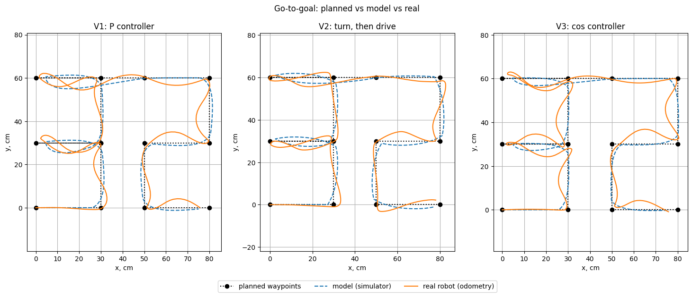

# Week 7: Go-to-goal

**Goal:** drive the digit **32** (the last two digits of my student ID) as a list of waypoints. The robot estimates its own position with the week 6 odometry and steers to one waypoint after another with a go-to-goal controller. Each program runs first in the TRIK Studio simulator, then on the real robot, and the two runs are compared in Colab. Three versions with three different controllers were tuned and tested.

## Files in this folder

| File | What it is |
|---|---|
| `go_to_goal_v1_sim.qrs`, `go_to_goal_v1_real.qrs` | V1: P controller |
| `go_to_goal_v2_sim.qrs`, `go_to_goal_v2_real.qrs` | V2: turn, then drive |
| `go_to_goal_v3_sim.qrs`, `go_to_goal_v3_real.qrs` | V3: cos controller |
| `odometry_data_sim_32_v1.txt` … `_v3.txt` | Simulator logs |
| `odometry_data_real_32_v1.txt` … `_v3.txt` | Real robot logs |
| `lab7_task_go_to_goal.ipynb` | Colab notebook: trajectory plot, waypoint-miss table and run times for all three versions |

## 1. Waypoints

The robot starts at (0, 0), facing +x. The digit is a list of 12 waypoints in cm, stored in the program as two arrays, `xg` (x values) and `yg` (y values):

```
digit 3: (0,0) → (30,0) → (30,30) → (0,30) → (30,30) → (30,60) → (0,60)
gap:     (0,60) → (50,60)
digit 2: (50,60) → (80,60) → (80,30) → (50,30) → (50,0) → (80,0)

xg = {30, 30, 0, 30, 30, 0, 50, 80, 80, 50, 50, 80}
yg = {0, 30, 30, 30, 60, 60, 60, 60, 30, 30, 0, 0}
```


## 2. One control step

### Step 1: Odometry, where am I? (`x`, `y`, `theta`)

E3 is the left wheel, E4 the right wheel:

```
aL = encoder3 · π / 180         aR = encoder4 · π / 180        wheel angles, degrees → rad
S     = (aR + aL) · r / 2       path travelled by the robot's centre
theta = (aR − aL) · r / B       course: how far the robot has turned from its start direction
x = x + (S − S_old) · cos(theta)
y = y + (S − S_old) · sin(theta)
```

- The encoders are cleared at the start, so the robot starts at x = 0, y = 0, `theta` = 0.


### Step 2: Distance to waypoint (`rho`)

```
dx = xg[i] − x        dy = yg[i] − y
rho = √(dx² + dy²)
```

`rho` sets the forward speed (slow down near the waypoint) and decides when the waypoint is reached.

### Step 3: Bearing to waypoint, with `atan2` (`thetaG`)

```
thetaG = atan2(dy, dx)
```

`thetaG` is the direction from the robot to the waypoint, measured from the +x axis, between −π and π.


### Step 4: Course angle (heading error), and wrapping it (`eTheta`)

```
eTheta = thetaG − theta
while |eTheta| > π:   eTheta = eTheta − sgn(eTheta) · 2π
```

`eTheta` is how far the robot has to turn to face the waypoint: positive means turn left, negative means turn right.

### Step 5: Forward power (`v`)

This is the only step that differs between the three versions (section 3).

### Step 6: Angular velocity (`w`)

```
w = Kth · eTheta
```

The further the robot points away from the waypoint, the harder it turns. When it points straight at the waypoint, `w` = 0. The sign of `eTheta` sets the direction.

### Step 7: Wheel powers (`vL`, `vR`)

```
vR = v + w · B / 2       → motor M4 (right)
vL = v − w · B / 2       → motor M3 (left)
```


### Step 8: Reached? Go to the next waypoint (`eps`)

The inner loop runs while `rho > eps`. Once the robot is within `eps` (the acceptance radius) of the waypoint, the program sets `i = i + 1` and `rho = 100` and starts on the next waypoint. After the last one it stops the motors.

### Step 9: Log and wait

Each pass writes one line `x,y,time` to the log file (Write To File) and waits 20 ms (Timer). 

## 3. Three controllers for the forward power `v`

The three versions use the same steps 1 to 4 and 6 to 9. They differ only in how `v` is chosen.

| Version | Forward power `v` | 
|---|---|
| V1: P controller | `min(Kv·rho, vMax)` | 
| V2: turn, then drive | `0` while `\|eTheta\| > turnErr`, otherwise `max(vMin, min(Kv·rho, vMax))` | 
| V3: cos controller | `min(Kv·rho, vMax) · cos(eTheta)` | 

### V1: P controller

```
v = min(Kv · rho, vMax)
```

- Far from the waypoint, `Kv · rho` is large and `v` is capped at `vMax=40%`, so the robot drives at a steady top speed it can still steer.


### V2: turn, then drive

```
v = max(vMin, min(Kv · rho, vMax))
v = 0 while |eTheta| > turnErr
```

- If the waypoint is more than `turnErr` (0.5 rad ≈ 29°) off, the robot stops and rotates on the spot. Then it drives with only a small error left, which `w` corrects. 
- `vMin` = 18 % is `minPower`. 
- In the block code the "v = 0" rule is one formula, `v = v · (1 + sgn(turnErr − |eTheta|)) / 2`. When |eTheta| < turnErr, `sgn` gives +1 and `v` stays; when |eTheta| > turnErr, `sgn` gives −1 and `v` becomes 0. This keeps the controller in one Function block, without an If block.

### V3: cos controller

```
v = min(Kv · rho, vMax) · cos(eTheta)
```

- `cos(eTheta)` is the share of the robot's forward motion that points at the waypoint:

  | Course angle | `cos` | Forward power |
  |---|---|---|
  | 0° | 1 | full |
  | 60° | 0.5 | half |
  | 90° | 0 | none: driving forward would only move it sideways to the waypoint, so it only turns |
  | 180° | −1 | full, backwards: the waypoint is behind, so it backs up toward it while turning |

- It works like V2 without a threshold: the robot slows down smoothly as the error grows instead of stopping at a fixed angle.
- `Go-to-goal_modeling.ipynb` limits the speed with `tanh`. TRIK has no `tanh`, so V3 uses the README's `min(Kv · rho, vMax)` instead.

### Gains

| | `Kv` | `Kth` | `vMax`, % | `vMin`, % | `eps`, cm | `turnErr`, rad |
|---|---|---|---|---|---|---|
| V1 | 4 | 8 | 40 | - | 5 | - |
| V2 | 4 | 5 | 50 | 18 | 3 | 0.5 |
| V3 | 4 | 8 | 40 | - | 5 | - |


## 4. How the program is built

1. Clear Encoder, Remove File (old log), and a Function that sets `r`, `B`, the gains, the waypoint arrays `xg`, `yg` and the start pose.
2. **Outer loop** `i < n`: one pass per waypoint.
3. **Inner loop** `rho > eps`, one control step:
   - odometry Function (steps 1 to 4);
   - wrap loop (step 4);
   - control Function (steps 5 to 7, and the log line);
   - Motors M3, M4;
   - Write To File;
   - Timer 20 ms.
4. Next waypoint (`i = i + 1`, `rho = 100`), and after the last one, Stop Motors.

**Simulator vs real program.** Same blocks and gains. Only these differ:

| | `_sim.qrs` | `_real.qrs` |
|---|---|---|
| `r`, `B` | 2.8 cm, 15.4 cm (TRIK Studio 2D robot) | 4.3 cm, 19.6 cm (real robot, measured in week 2) |
| Log file | `odometry_data_sim_32_vN.txt` | `odometry_data_real_32_vN.txt` |
| Marker Down / Marker Up | yes, so the simulator draws the path | no |

## 5. How the data is organized

One line per sample, no header: `x,y,time`, with `x`, `y` in **cm** and `time` in **ms** since the program started. For example, `30.086,-0.389,1518` means: 1.518 s after the start, the robot believed it was at x = 30.1 cm, y = −0.4 cm.

- Simulator: one line every 20 ms.
- Real robot: about one line every 60 ms (writing to the file takes time on the robot).

## 6. Results

| | Run time, sim / real | Mean waypoint miss, sim / real | Worst waypoint miss, sim / real |
|---|---|---|---|
| V1: P controller | 35.8 s / 16.3 s | 2.6 cm / 1.5 cm | 5.0 cm / 4.5 cm |
| V2: turn, then drive | 41.9 s / 19.4 s | 2.0 cm / 1.1 cm | 2.9 cm / 2.9 cm |
| V3: cos controller | 36.7 s / 18.5 s | 3.1 cm / 1.9 cm | 4.9 cm / 4.3 cm |

## Discussion

**1. Which corners were cut or overshot, and why**

- **All versions cut corners by up to `eps`.** The robot switches to the next waypoint `eps` before the corner: 5 cm for V1 and V3, 3 cm for V2. That is why V2 has the smallest misses.
- **V1 swings out widest at the two 180° reversals of the 3.** It keeps full forward power while turning around.
- **V3 has the same gains as V1 but squarer corners.** `cos(eTheta)` slows it down while it is badly aimed. In the simulator it stays within 3.2 cm of the planned path, against 5.0 cm for V1.
- **On the real robot, V2 overshot (30,0), (50,0) and (80,60) by about 3 cm.** It switches only 3 cm before each corner, and the real robot keeps rolling for a moment after the switch (T_m ≈ 0.2 s, from week 5).

**2. Real robot vs simulator**

- **V1 and V3 weave across the straight lines on the real robot, but not in the simulator.** This is the lecture's "`Kth` too high" oscillation: the real motors react with a delay, and the real loop runs every 60 ms instead of 20 ms. V2, with `Kth` = 5, barely weaves.
- **The gap visible in these plots is a control problem.** Both curves are the robot's own odometry, and by that estimate the real robot reached every waypoint within `eps`. Localization errors, such as wheel slip or a wrong `r` or `B`, cannot show up in these logs at all; checking them would need an outside measurement, such as the tape measurement.

  

