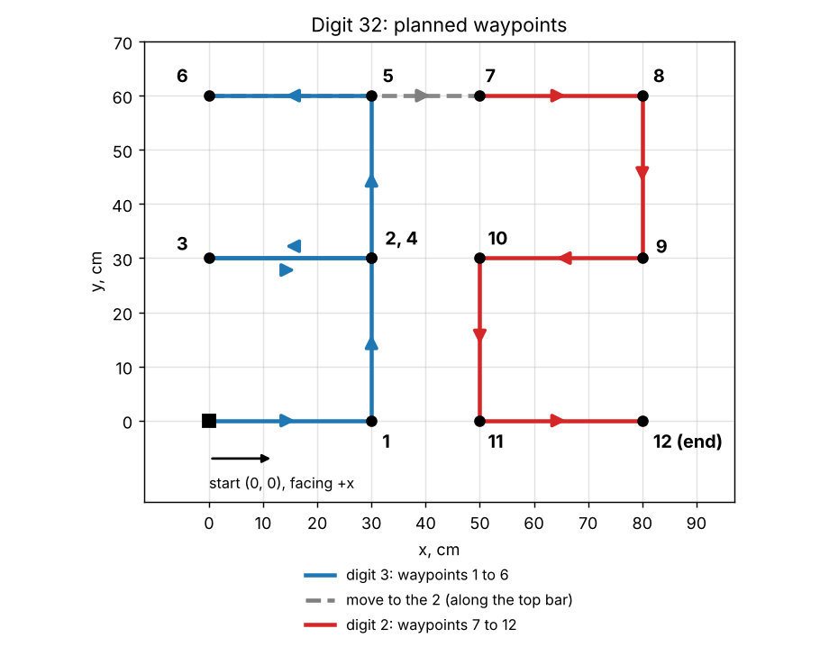

# Week 7: Go-to-goal

**Goal:** drive the digit **32** (the last two digits of my student ID) as a list of waypoints. The robot estimates its own position with the week 6 odometry and steers to one waypoint after another with a go-to-goal controller. Each program runs first in the TRIK Studio simulator, then on the real robot, and the two runs are compared in Colab. Three versions with three different controllers were tuned and tested.

## Files in this folder

| File | What it is |
|---|---|
| `go_to_goal_v1_sim.qrs`, `go_to_goal_v1_real.qrs` | V1: P controller |
| `go_to_goal_v2_sim.qrs`, `go_to_goal_v2_real.qrs` | V2: turn, then drive |
| `go_to_goal_v3_sim.qrs`, `go_to_goal_v3_real.qrs` | V3: cos controller |
| `odometry_data_sim_32_v1.txt` … `_v3.txt` | Simulator logs |
| `odometry_data_real_32_v1.txt` … `_v3.txt` | Real robot logs |
| `lab7_task_go_to_goal.ipynb` | Colab notebook: trajectory plot, waypoint-miss table and run times for all three versions |

## 1. Waypoints

The robot starts at (0, 0), facing +x. The digit is a list of 12 waypoints in cm, stored in the program as two arrays, `xg` (x values) and `yg` (y values):

```
digit 3: (0,0) → (30,0) → (30,30) → (0,30) → (30,30) → (30,60) → (0,60)
gap:     (0,60) → (50,60)
digit 2: (50,60) → (80,60) → (80,30) → (50,30) → (50,0) → (80,0)

xg = {30, 30, 0, 30, 30, 0, 50, 80, 80, 50, 50, 80}
yg = {0, 30, 30, 30, 60, 60, 60, 60, 30, 30, 0, 0}
```


## 2. One control step

### Step 1: Odometry, where am I? (`x`, `y`, `theta`)

E3 is the left wheel, E4 the right wheel:

```
aL = encoder3 · π / 180         aR = encoder4 · π / 180        wheel angles, degrees → rad
S     = (aR + aL) · r / 2       path travelled by the robot's centre
theta = (aR − aL) · r / B       course: how far the robot has turned from its start direction
x = x + (S − S_old) · cos(theta)
y = y + (S − S_old) · sin(theta)
```

- The encoders are cleared at the start, so the robot starts at x = 0, y = 0, `theta` = 0.
- `theta` comes straight from the total wheel angles, without a running sum, so small rounding errors do not pile up from step to step.
- `x` and `y` must be added up step by step, because where the robot ends up depends on the direction of every piece of the path.
- Each step assumes `theta` stays the same for 20 ms. The steps are short, so the error from this is small.

### Step 2: Distance to waypoint (`rho`)

```
dx = xg[i] − x        dy = yg[i] − y
rho = √(dx² + dy²)
```

`rho` sets the forward speed (slow down near the waypoint) and decides when the waypoint is reached.

### Step 3: Bearing to waypoint, with `atan2` (`thetaG`)

```
thetaG = atan2(dy, dx)
```

`thetaG` is the direction from the robot to the waypoint, measured from the +x axis, between −π and π.

Why `atan2` and not `atan(dy / dx)`:
- **`atan` cannot tell front from back.** It only returns angles between −90° and +90°. For dx = 10, dy = 10 and for dx = −10, dy = −10, `dy / dx` is 1 both times, so `atan` gives 45° for both. `atan2` looks at the signs of `dy` and `dx` separately and gives 45° and −135°.
- **`atan(dy / dx)` breaks when dx is close to 0.** That happens on every vertical line of the 32, for example from (30,0) to (30,30). When the robot drifts a little left or right of x = 30, `dy / dx` blows up and changes sign, so `atan` jumps between +90° and −90° (and at dx = 0 it divides by zero). `atan2` stays close to 90° the whole time.

### Step 4: Course angle (heading error), and wrapping it (`eTheta`)

```
eTheta = thetaG − theta
while |eTheta| > π:   eTheta = eTheta − sgn(eTheta) · 2π
```

`eTheta` is how far the robot has to turn to face the waypoint: positive means turn left, negative means turn right.

**Why wrap.** Two angles that differ by a full turn (2π, 360°) point the same way, but the controller turns in proportion to the number. `theta` from odometry keeps counting every turn the robot makes, while `thetaG` from `atan2` always stays between −180° and 180°.
- Example: after one full left turn the robot faces +x again and `theta` = 360°. With the waypoint straight ahead, `thetaG` = 0° and the raw error is −360°, so the robot would spin a whole circle to the right for nothing. Wrapped, the error is 0° and it drives straight on.
- Wrapping keeps the error between −π and π, so the robot always turns the shorter way round.

**Why a loop and not one `if`.** Subtracting 2π once only fixes errors up to 3π (540°). In the simulator `theta` grew past 720° while drawing the 32, so the raw error could be more than two full turns. The loop repeats the subtraction until the error is in range: for `theta` = 730° and `thetaG` = 0°, it goes −730° → −370° → −10°, a small turn right.
- `sgn(eTheta)` picks the direction: it subtracts 2π from a positive error and adds 2π to a negative one.
- This is the subtraction from `Fixed_1x1_trajectory.qrs`, repeated in a loop like the `while a > pi` loops in `localization+point_to_point.py`.

### Step 5: Forward power (`v`)

This is the only step that differs between the three versions (section 3).

### Step 6: Angular velocity (`w`)

```
w = Kth · eTheta
```

The further the robot points away from the waypoint, the harder it turns. When it points straight at the waypoint, `w` = 0. The sign of `eTheta` sets the direction.

### Step 7: Wheel powers (`vL`, `vR`)

```
vR = v + w · B / 2       → motor M4 (right)
vL = v − w · B / 2       → motor M3 (left)
```

- A differential-drive robot turns by running its two wheels at different speeds.
- `v` is the common part that moves the robot forward. `w · B / 2` is added to one wheel and taken from the other, because each wheel sits B/2 from the robot's centre.
- Positive `w` makes the right wheel faster, so the robot turns left.
- All values are motor power in %, so the gains work in % too.

### Step 8: Reached? Go to the next waypoint (`eps`)

The inner loop runs while `rho > eps`. Once the robot is within `eps` (the acceptance radius) of the waypoint, the program sets `i = i + 1` and `rho = 100` and starts on the next waypoint. After the last one it stops the motors.

- **Why `eps`:** the robot never lands exactly on a point. Without an acceptance radius it would keep circling around the waypoint.
- **Why `rho = 100`:** so the inner loop condition is true again before the distance to the new waypoint is computed. `Fixed_1x1_trajectory.qrs` does the same with `dist = 100`.
- **The cost:** the robot turns toward the next waypoint `eps` early, so every corner is rounded by up to `eps` (see Results).

### Step 9: Log and wait

Each pass writes one line `x,y,time` to the log file (Write To File) and waits 20 ms (Timer). The old log is deleted at the start (Remove File), because Write To File adds to the end of an existing file and the old run would mix with the new one.

## 3. Three controllers for the forward power `v`

The three versions use the same steps 1 to 4 and 6 to 9. They differ only in how `v` is chosen.

| Version | Forward power `v` | Source in the course materials |
|---|---|---|
| V1: P controller | `min(Kv·rho, vMax)` | Lab 7 README table |
| V2: turn, then drive | `0` while `\|eTheta\| > turnErr`, otherwise `max(vMin, min(Kv·rho, vMax))` | `localization+point_to_point.py` (`forward = 0` above an angle limit, `minPower`) |
| V3: cos controller | `min(Kv·rho, vMax) · cos(eTheta)` | `Fixed_1x1_trajectory.qrs` (`mov = 50 * dist * cos(err)`); the `cos · tanh` law in `Go-to-goal_modeling.ipynb` |

### V1: P controller

```
v = min(Kv · rho, vMax)
```

- Far from the waypoint, `Kv · rho` is large and `v` is capped at `vMax`, so the robot drives at a steady top speed it can still steer.
- Within `vMax / Kv` = 10 cm of the waypoint, `v` falls in proportion to the distance, so the robot slows down as it arrives instead of overshooting.
- **Weak point:** it ignores the heading error. It drives at full power even when the waypoint is behind it, so it turns while driving and swings wide at sharp corners.

### V2: turn, then drive

```
v = max(vMin, min(Kv · rho, vMax))
v = 0 while |eTheta| > turnErr
```

- If the waypoint is more than `turnErr` (0.5 rad ≈ 29°) off, the robot stops and rotates on the spot. Then it drives with only a small error left, which `w` corrects. This is the lecture's turn-then-drive choice: sharper corners, slower runs.
- `vMin` = 18 % is `minPower` from the professor's script. Very low power may not move the real robot on the floor, so without it the robot could stall just before a waypoint and never get within `eps`. This is what makes the smaller `eps` = 3 cm safe for V2.
- In the block code the "v = 0" rule is one formula, `v = v · (1 + sgn(turnErr − |eTheta|)) / 2`. When |eTheta| < turnErr, `sgn` gives +1 and `v` stays; when |eTheta| > turnErr, `sgn` gives −1 and `v` becomes 0. This keeps the controller in one Function block, without an If block.

### V3: cos controller

```
v = min(Kv · rho, vMax) · cos(eTheta)
```

- `cos(eTheta)` is the share of the robot's forward motion that points at the waypoint:

  | Course angle | `cos` | Forward power |
  |---|---|---|
  | 0° | 1 | full |
  | 60° | 0.5 | half |
  | 90° | 0 | none: driving forward would only move it sideways to the waypoint, so it only turns |
  | 180° | −1 | full, backwards: the waypoint is behind, so it backs up toward it while turning |

- It works like V2 without a threshold: the robot slows down smoothly as the error grows instead of stopping at a fixed angle.
- `Go-to-goal_modeling.ipynb` limits the speed with `tanh`. TRIK has no `tanh`, so V3 uses the README's `min(Kv · rho, vMax)` instead.

### Gains

| | `Kv` | `Kth` | `vMax`, % | `vMin`, % | `eps`, cm | `turnErr`, rad |
|---|---|---|---|---|---|---|
| V1 | 4 | 8 | 40 | - | 5 | - |
| V2 | 4 | 5 | 50 | 18 | 3 | 0.5 |
| V3 | 4 | 8 | 40 | - | 5 | - |

How they were chosen:
- **V1 and V3 share all gains**, so `cos(eTheta)` is the only difference between them.
- **`eps` depends on the lowest power.** In V1 and V3 the power just before a waypoint is `Kv · eps` = 4 × 5 = 20 %, just above the 18 % `minPower`. A smaller `eps` could leave the real robot stopped short of a waypoint. V2 never drops below `vMin`, so it can use `eps` = 3 cm.
- **`turnErr` = 0.5 rad** (the course script uses 1.0) gives sharper corners. Smaller values could make the on-the-spot turning power `Kth · turnErr · B / 2` too small to move the real robot.
- **`Kth`:** 8 gives tight turns while driving in V1 and V3. In tuning runs on a model of the simulator robot, the loops at the two reversals of the 3 strayed about 11 cm from the path with `Kth` = 5 and about 5 cm with 8. V2 does its big turns on the spot, so 5 is enough. The lecture warns that a `Kth` that is too high makes the robot oscillate around the line.

## 4. How the program is built

The block structure follows the professor's `Fixed_1x1_trajectory.qrs`:

1. Clear Encoder, Remove File (old log), and a Function that sets `r`, `B`, the gains, the waypoint arrays `xg`, `yg` and the start pose.
2. **Outer loop** `i < n`: one pass per waypoint.
3. **Inner loop** `rho > eps`, one control step:
   - odometry Function (steps 1 to 4);
   - wrap loop (step 4);
   - control Function (steps 5 to 7, and the log line);
   - Motors M3, M4;
   - Write To File;
   - Timer 20 ms.
4. Next waypoint (`i = i + 1`, `rho = 100`), and after the last one, Stop Motors.

**Simulator vs real program.** Same blocks and gains. Only these differ:

| | `_sim.qrs` | `_real.qrs` |
|---|---|---|
| `r`, `B` | 2.8 cm, 15.4 cm (TRIK Studio 2D robot) | 4.3 cm, 19.6 cm (real robot, measured in week 2) |
| Log file | `odometry_data_sim_32_vN.txt` | `odometry_data_real_32_vN.txt` |
| Marker Down / Marker Up | yes, so the simulator draws the path | no |

## 5. How the data is organized

One line per sample, no header: `x,y,time`, with `x`, `y` in **cm** and `time` in **ms** since the program started. For example, `30.086,-0.389,1518` means: 1.518 s after the start, the robot believed it was at x = 30.1 cm, y = −0.4 cm.

- Simulator: one line every 20 ms.
- Real robot: about one line every 60 ms (writing to the file takes time on the robot).

## 6. Results

| | Run time, sim / real | Mean waypoint miss, sim / real | Worst waypoint miss, sim / real |
|---|---|---|---|
| V1: P controller | 35.8 s / 16.3 s | 2.6 cm / 1.5 cm | 5.0 cm / 4.5 cm |
| V2: turn, then drive | 41.9 s / 19.4 s | 2.0 cm / 1.1 cm | 2.9 cm / 2.9 cm |
| V3: cos controller | 36.7 s / 18.5 s | 3.1 cm / 1.9 cm | 4.9 cm / 4.3 cm |

The waypoint miss is the smallest distance between the logged path and each waypoint. The mean and worst are over waypoints 1 to 12, from the notebook's waypoint-miss table.

- **Every miss is within `eps`,** so every version reached all 12 waypoints in both runs.
- **The real robot is about twice as fast:** bigger wheels and faster motors at the same power.
- **V2 is the most accurate and the slowest** in both runs.
- **End point:** the tape measurement was not required this week. The last odometry lines are (75.5, 0.1), (78.0, 2.2) and (75.8, −0.9) cm for V1, V2 and V3. Each is within `eps` of (80, 0), because the program stops as soon as the robot is within `eps` of the last waypoint.

## Discussion

Every version cuts each corner by up to ε (5 cm for V1 and V3, 3 cm for V2), because it switches to the next waypoint ε early, which is why V2 has the smallest misses. V1 swings out widest at the two 180° reversals, because it keeps full forward power while turning. V3 has the same gains but slows down with `cos(e_θ)`, so in the simulator it stays closer to the planned path (at most 3.2 cm away, against 5.0 cm for V1). On the real robot, V2 overshot (30,0), (50,0) and (80,60) by about 3 cm: it switches only 3 cm before each corner, and the robot keeps rolling for a moment after the switch (T_m ≈ 0.2 s in week 5). V1 and V3 weave across the straight lines on the real robot but not in the simulator, which matches the lecture's "K_θ too high" oscillation: the real motors lag and the loop runs every 60 ms instead of 20 ms, while V2 with K_θ = 5 barely weaves. The remaining real-vs-model gap in these plots is a **control** problem, because both curves are odometry and the real robot still reached every waypoint within ε by its own estimate; localization errors such as wheel slip or a wrong r or B cannot show up in these logs at all.
